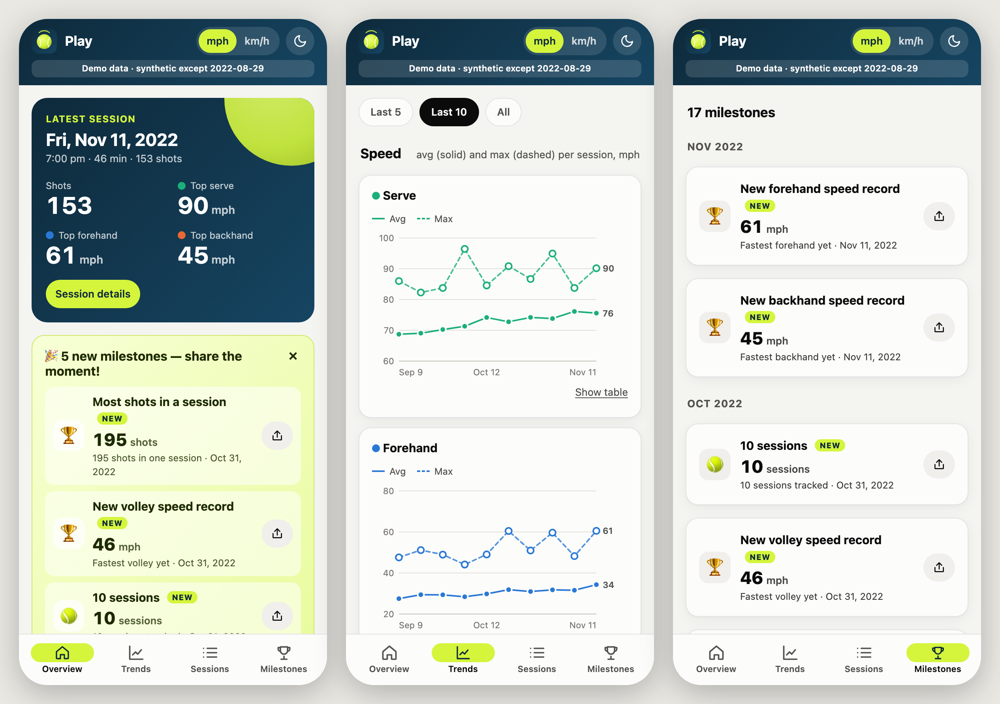
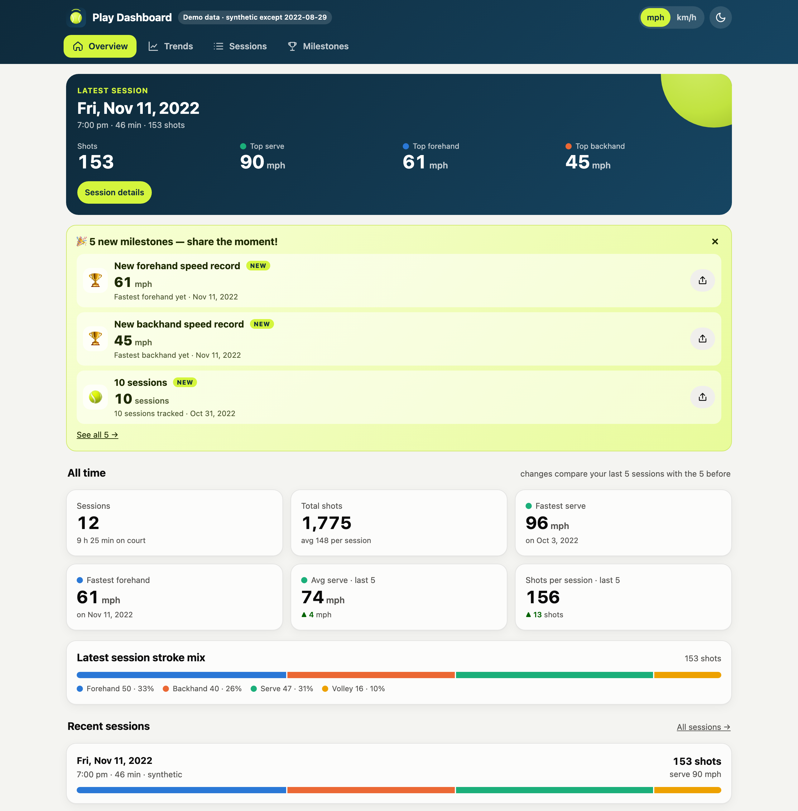
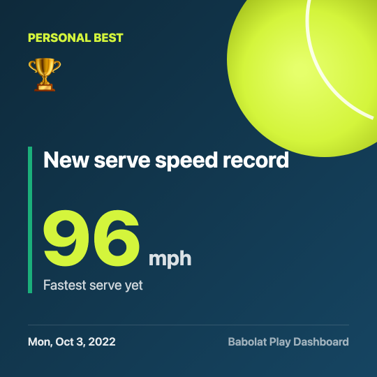
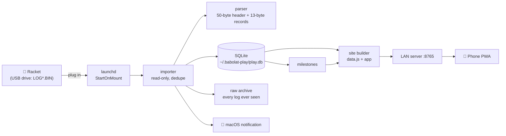

# Babolat Play Dashboard

**Your Babolat Play racket data, back in your hands.** Babolat no longer supports the official Play app, but the sensor in your racket still records every swing. This project reads the racket over USB, keeps your full history on your own computer, and serves a phone-friendly dashboard with trends, personal bests and milestones you can share.



> Not affiliated with or endorsed by Babolat. "Babolat" and "Babolat Play" are trademarks of their owner and are used here only to describe compatibility.

## Features

- **Plug in and it's done (macOS).** When the racket mounts, new sessions are imported automatically and you get a notification. Sessions already imported are skipped, and a log that has grown since the last import is updated.
- **Trends across sessions.** Average and top speed for serve, forehand and backhand, shot mix, spin share and volume. Filter to the last 5 or 10 sessions, or all of them.
- **Per-session detail.** Stroke counts, average and max speed, topspin/slice/flat split, a timeline in 5-minute bins and the full swing list.
- **Milestones worth celebrating.** Personal bests, shot totals (500, 1k, 2.5k…), session counts and weekly streaks. New ones are highlighted after each import, and **Share** turns any milestone into an image card for your group chat.
- **Installable on your phone.** The Mac serves the dashboard on your home Wi-Fi. Open it on your phone and add it to your home screen. It works offline and in light and dark mode, with mph or km/h.
- **Private and simple.** Your data stays on your computer. It needs only Python 3.9+ with no packages to install, the dashboard loads nothing from the internet, and **the racket is only ever read, never written to**.

| Desktop | Share card |
|---|---|
|  |  |

## Quick start (macOS)

```bash
git clone https://github.com/sgupta382/babolat-play-dashboard.git
cd babolat-play-dashboard
python3 -m babolat_play install
```

`install` sets up two background agents:
1. One imports from the racket whenever it's plugged in.
2. One serves the dashboard on port 8765.

It also runs a first import straight away and prints your dashboard's address. Then:

1. On your phone, on the same Wi-Fi, open the printed address, for example `http://your-mac.local:8765`.
2. **iPhone:** Share → *Add to Home Screen*. **Android:** ⋮ → *Install app*.
3. Next time you play, plug the racket into the Mac. The dashboard updates by itself.

Keep the cloned folder where it is, because the agents run the code from there. To remove the agents, run `python3 -m babolat_play uninstall`. Your data stays in `~/.babolat-play/`.

### Just want to look?

```bash
python3 -m babolat_play demo && open site-demo/index.html
```

The demo uses one real session (2022-08-29) plus 11 **synthetic** sessions, so the trend charts have something to show.

## Manual use (any OS)

```bash
python3 -m babolat_play import                       # auto-detects a volume named BABOLAT
python3 -m babolat_play import --path /media/BABOLAT # or point at the racket / a folder of LOG*.BIN files
python3 -m babolat_play serve                        # dashboard on http://<this-computer>:8765
python3 -m babolat_play status                       # what's imported, what's installed
```

| Command | What it does |
|---|---|
| `import [--path P] [--min-swings 10]` | Import new sessions, update milestones and rebuild the dashboard |
| `build` | Rebuild the dashboard from stored data |
| `serve [--port 8765]` | Serve the dashboard on your network (read-only) |
| `install [--no-serve]` / `uninstall` | macOS: add or remove the auto-import and server agents |
| `demo [--out site-demo]` | Build the demo dashboard |
| `status` | Show the session count, last import, agents and URLs |

## How it works



More detail is in [docs/ARCHITECTURE.md](docs/ARCHITECTURE.md).

## How accurate is it?

The racket's file format was never published, so it was reverse-engineered for this project:

- **Verified:** the file layout, session start times, the number of swings and the time of each swing.
- **Inferred from the data:** stroke type, spin and speed. They behave the way you'd expect (serves fastest, forehands mostly topspin, backhands mostly slice), but no recorded session has been checked against known shots yet.
- **Not decoded:** overheads, impact location and other fields.

[docs/FILE_FORMAT.md](docs/FILE_FORMAT.md) gives the evidence for every byte. **You can help improve it.** Record a labelled session and share it; [CONTRIBUTING.md](CONTRIBUTING.md) explains how.

Raw logs are archived in `~/.babolat-play/raw/`, so when the decoding improves, `python3 -m babolat_play build` can re-decode your whole history.

## Privacy

- Everything stays on your computer.
- The server only answers on your local network, serves static files, and has no write endpoints and no directory listings.
- Nothing is sent to the internet.
- Anyone on your Wi-Fi who knows the address can view the dashboard. Use `install --no-serve` if you don't want that.

## Troubleshooting

- **"Can't read the racket" notification, or nothing imports automatically.** macOS asks before background apps can read USB drives. Open *System Settings → Privacy & Security → Files & Folders* and allow **Removable Volumes** for `python3`. You can also add the interpreter shown by `python3 -c "import sys; print(sys.executable)"` to *Full Disk Access*. Then plug the racket in again. Logs are in `~/.babolat-play/agent.log`.
- **The phone can't open `your-mac.local`.** Use the IP address that `status` prints instead, for example `http://192.168.1.20:8765`. Make sure both devices are on the same Wi-Fi and that the macOS firewall allows incoming connections for Python.
- **Port 8765 is in use.** Run `python3 -m babolat_play install --port 8877`.
- **The racket doesn't mount.** Charge it, then use a data-capable USB cable. It appears as a small drive named `BABOLAT`.
- **The share button downloads instead of opening the share sheet.** Browsers only allow native sharing over HTTPS. Over plain `http://` on your Wi-Fi, the card opens as an image: press and hold it to save or share.

## Development

```bash
python3 -m unittest discover -s tests -v   # standard library only, no installs needed
python3 -m babolat_play demo && tools/screenshots.sh site-demo docs/img
```

The code is organised like this:
- `babolat_play/` holds the Python package: parser, store, importer, milestones, site, server, agent and CLI.
- `babolat_play/app/` holds the dashboard: plain HTML, CSS and JS with no build step.

## License

[MIT](LICENSE)
