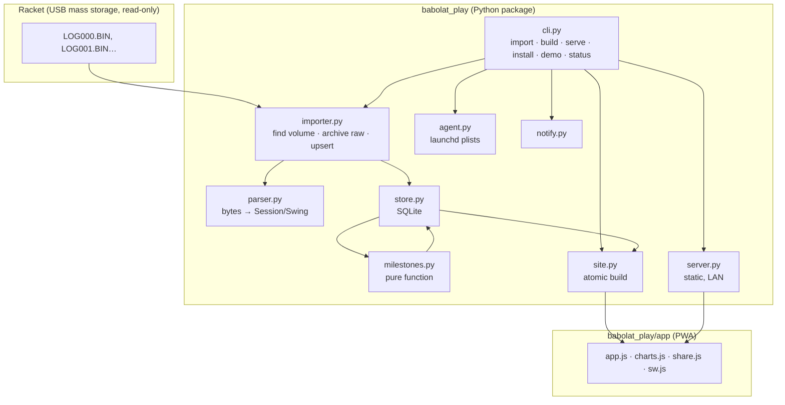
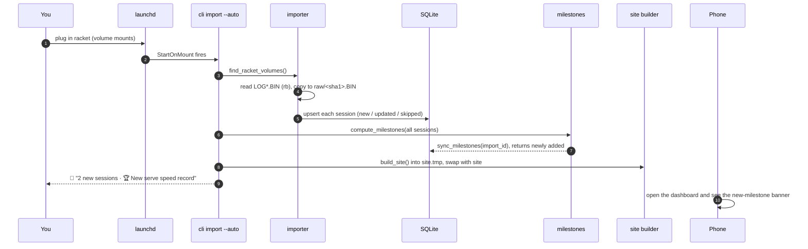
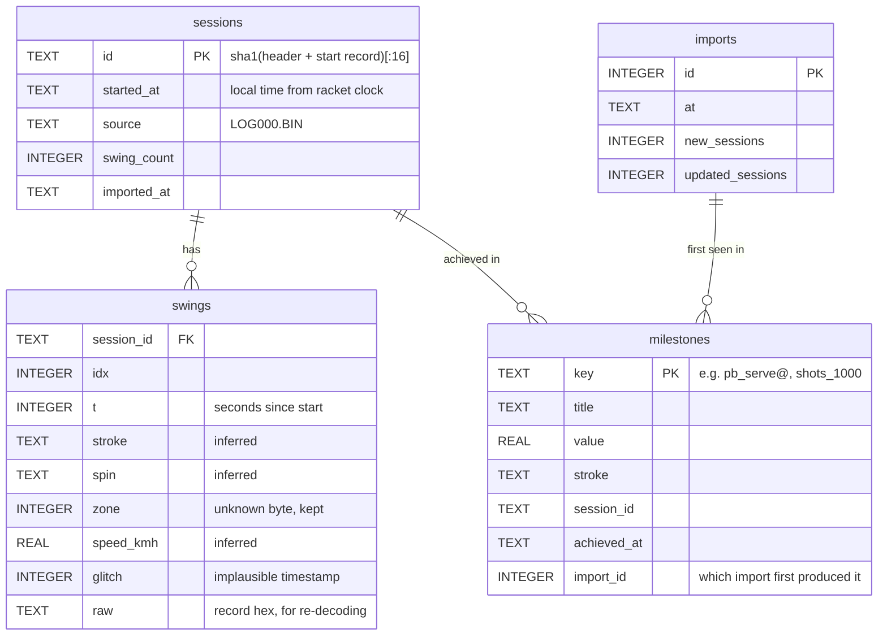

# Architecture

It's a small pipeline with one job per module. The Python side uses only the standard library (3.9+). The dashboard is static HTML, CSS and JS that reads one generated `data.js`.

## Components

| Module | Responsibility | Depends on |
|---|---|---|
| `parser.py` | Decodes a log into sessions and swings. Holds the format constants and the inferred mapping tables. | nothing |
| `store.py` | SQLite tables for sessions, swings, milestones and import runs. Idempotent upsert. | parser types |
| `importer.py` | Finds the racket, archives raw logs, parses them and upserts. Never writes to the volume. | parser, store |
| `milestones.py` | Session history → milestones. The same history always gives the same result. | parser types |
| `site.py` | Copies the app shell, writes `data.js` and swaps in the new site atomically. | store |
| `server.py` | `ThreadingHTTPServer` serving the site read-only. | nothing |
| `agent.py` | Writes, loads and unloads the launchd agents. | nothing |
| `cli.py` | Wires the modules together. | all |

## Import flow (racket plugged in)

If no racket is mounted, `--auto` exits quietly, because `StartOnMount` also fires for other drives. A `PermissionError` (macOS privacy settings) produces a notification that points at the README.

## Data model

## Rules for ignoring old data

1. **Session identity.** Each session's ID is a hash of the log header plus its session-start record, which includes the start time to the second. It doesn't depend on how many swings follow, so a session keeps the same ID as the log grows.
2. **Upsert.** An unknown ID is inserted. A known ID with more swings than stored is replaced. Anything else is skipped. Plugging in the same racket twice changes nothing.
3. **Noise filter.** Sessions with fewer than 10 swings are skipped, which drops the factory test in `LOG001.BIN` (`--min-swings` changes the threshold).
4. **Milestones are recomputed from all history after each import.** A key that already exists keeps its original `import_id`, so only genuinely new achievements are flagged as new, even when an older session arrives late.

## Build safety

`build_site` writes into `site.tmp`, renames the live `site` to `site.old`, moves `site.tmp` into place and deletes `site.old`. If anything fails, the temp directory is removed and the live site is untouched.

## Dashboard

- **Rendering.** Hash routes (`#overview`, `#trends`, `#sessions`, `#session/<id>`, `#milestones`) render into one `<main>`. Charts are hand-rolled SVG (`charts.js`), with hover and tap tooltips, a table view for every chart, and redraws on resize and theme change.
- **Colors.** One fixed color per stroke, from a palette validated for color-vision deficiency in light and dark mode. Legends and direct labels are always present, so color is never the only cue.
- **Offline.** `sw.js` caches the app shell (stale-while-revalidate) and fetches `data.js` network-first, so the phone shows the newest stats when the Mac is reachable and the last copy when it isn't.
- **Sharing.** `share.js` draws a 1080×1080 PNG on a canvas. It uses `navigator.share` where the browser allows it (HTTPS or localhost) and otherwise shows the image so you can save it.
